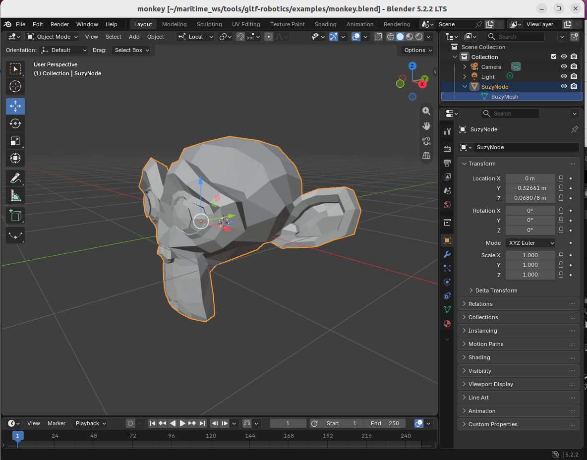
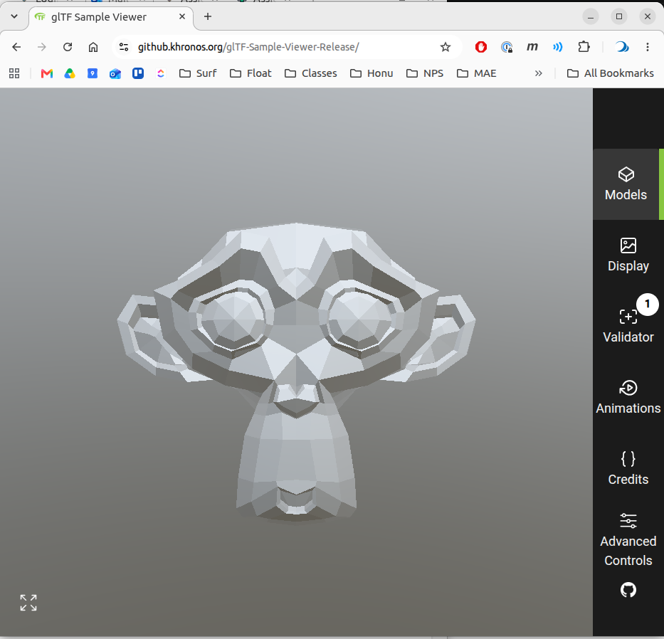
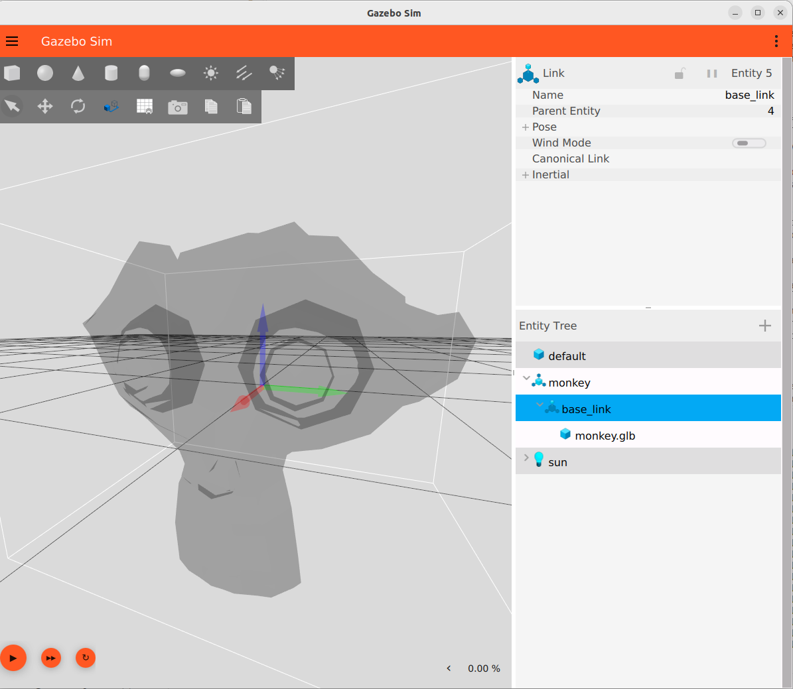
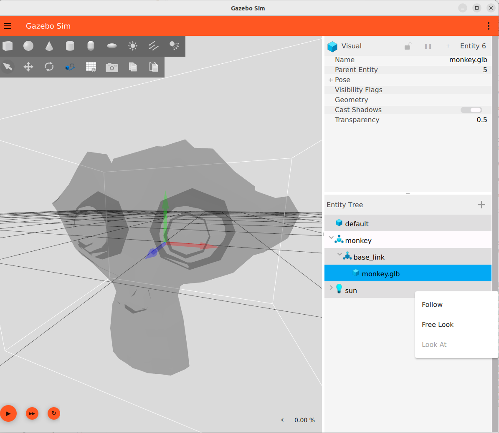
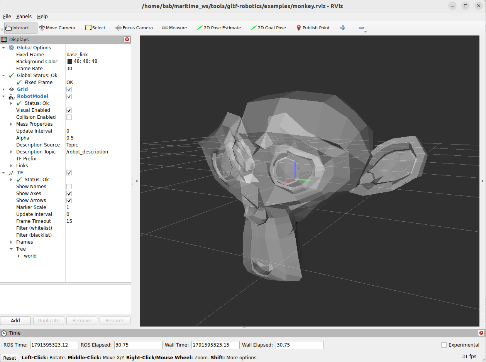
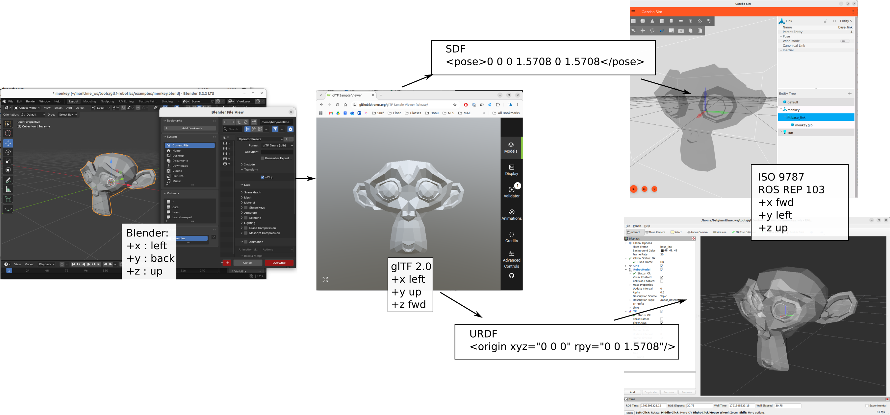

# Coordinate system orientation demonstration


This is meant as the simplest possible workflow to demonstrate the workflow and test various assumptions and conventions and to verify the utilities and claims.  Maintaining consistency across 3D authoring (Blender), glTF (glTF previewer), Gazebo and RVIZ requires carefully specifying the convention used at each step and what transforms are done (and how) in each translation step.  This is meant as to demonstrate and reinforce the coordinate system conventions in [profile.md] an [workflow.md] in a minimal way.  The intent is to provide clarity and brevity to that participants at each stage in the process know what to expect and what to produce. 

There are two aspects of specifying coordinate systems relative to asset geometry:

1. Datum location: the origin of the coordinate system of the mesh coordinates.  This is covered in [profile.md (Datum Specification)]
2. The orientation of the mesh coordinate system relative to the semantic directions of `front`/`back`, `left`/`right` and `up`/`down`.    The orientation convention and transformation.

## The overarching structure  

The key design conventions chosen for the [profile.md] an [workflow.md] in a minimal way so it is clear to all participants at each stage in the process what to expect for coordinate system orientation.   


For each stage in the workflow, we use the standards and/or convention of that tool and/or typical application.


% CLAUDE: Put a table here of the coordinate conventions.  I've roughed it out below
|         | +x | + y | +z | 
| Blender
| glTF
| ISO/ROS % CLAUDE: fill in numbers

% % CLAUDE: Also, as a visual a flow chart to show each viewer (tool), the convention it uses, and then arrows to show what each tool does and what users do at each step.
1. Blender - design 3d geometry using Blender convention
2. Blender export - check Y-up, does rotation from Blender coordinates to glTF
3. glTF viewer - imports with no transform, viewer is now showing glTF convention
4. Assimp loader
4-5. Assimp to GGazebo - uses ISO/ROS REP convention, inmports with no transform, we add the additional SDF rotation to go from glTF convention to ISO/ROS REP
4-6. Assimp to  RViz - RViz uses ISO/ROS Rep.  RVIz does autonmatic transform, se must (as policy) apply a different rotation to convert from gltF to ISO/ROS Rep and account for the RVIZ automatic (silent) transform


## Minimum monkey mesh 

### Create in Blender 

Add->Mesh->Monkey

* When first created the mesh has no transforms.  Global and local coordinate systems share the same origin location and orientation
    * +x: left
    * +y: back
    * +z: up

[tools/gltf-robotics/examples/monkey.blend]



### Export Blender -> glTF 
Export to glTF 2.0: We **DO** select the **+Y Up option** for export

* There are 110 options in the export widget - many places to cause problems. 
* See [the export options reference](../reference/blender-export-options.md) for with the thirteen parameters that need to be verified/set.

The product of the export with **+Y Up option** selected is [tools/gltf-robotics/examples/monkey.glb]

### View in [gltF Sample Viewer](https://github.khronos.org/glTF-Sample-Viewer-Release/)

To view the exported `.glb` file, the [gltF Sample Viewer](https://github.khronos.org/glTF-Sample-Viewer-Release/) is released by the glTF maintainers.  The tool does not overtly show coordinate system axes, but the default is with `front` facing forward. 

If we open the export with **+Y Up option** selected is [tools/gltf-robotics/examples/monkey.glb] we see


#### glTF to Gazebo

Both Gazebo and RVIZ use the same AssimpLoader

By convension we apply two rotations to transform from the `.glb` file in glTF coordinate convention to the mesh geometry in ISO/ROS-REP convention. 
```
<model name="monkey"><static>true</static><pose>0 0 0 0 0 0</pose>
  <link name="base_link"><visual name="monkey.glb">
      <pose>0 0 0 1.5708 0 1.5708</pose>
      <geometry><mesh><uri>file:///PATH/gltf-robotics/examples/monkey.glb</uri></mesh></geometry></visual>
  </link>
</model>
```

The actual SDF we use is at [examples/monkey.sdf], but it contains absolute path and is included for reference only. Which we run (in the drydock container, gz sim 10.5.0 ) with

```
gz sim -v2 ~/maritime_ws/tools/gltf-robotics/examples/monkey.sdf
```

In Gazebo, we can visualize the `base_link` coordinate system ("frames" in Gazebo) to verify that they are indeed consistent with the ISO/ROS-REP convention.


We can also see that the glTF coordiante system is still intact, attached to the mesh, and consistent with glTF convention. 


#### glTF to RVIZ

By convention we apply a rotation about the `z` axis to transform from glTF to ISO/ROS-REP conventions.

```
  <link name="base_link">
    <visual>
      <origin xyz="0 0 0" rpy="0 0 1.5708"/>
      <geometry>
        <mesh filename="file:///home/bsb/maritime_ws/tools/gltf-robotics/examples/monkey.glb"/>
      </geometry>
    </visual>
  </link>
```

The actual source we use is at [examples/monkey.urdf], but again uses absolute paths to avoid any install, so is provided for reference only. 

The commands, for reference only, are, in a drydock container:

```
source /opt/ros/lyrical/setup.bash 
ros2 run robot_state_publisher robot_state_publisher --ros-args \
  -p robot_description:="$(cat ~/maritime_ws/tools/gltf-robotics/examples/monkey.urdf)"
```

```
source /opt/ros/lyrical/setup.bash 
rviz2 -d ~/maritime_ws/tools/gltf-robotics/examples/monkey.rviz
```

The result is


And shows that the geometry is imported and now complies wit the ISO/ROS-REP convention


### Summary

This image illustrates the flow from Blender to the Gazebo and RVIZ consumers and highlights the required transforms at each step, necessary to keep the conventions of each tool consistent.

