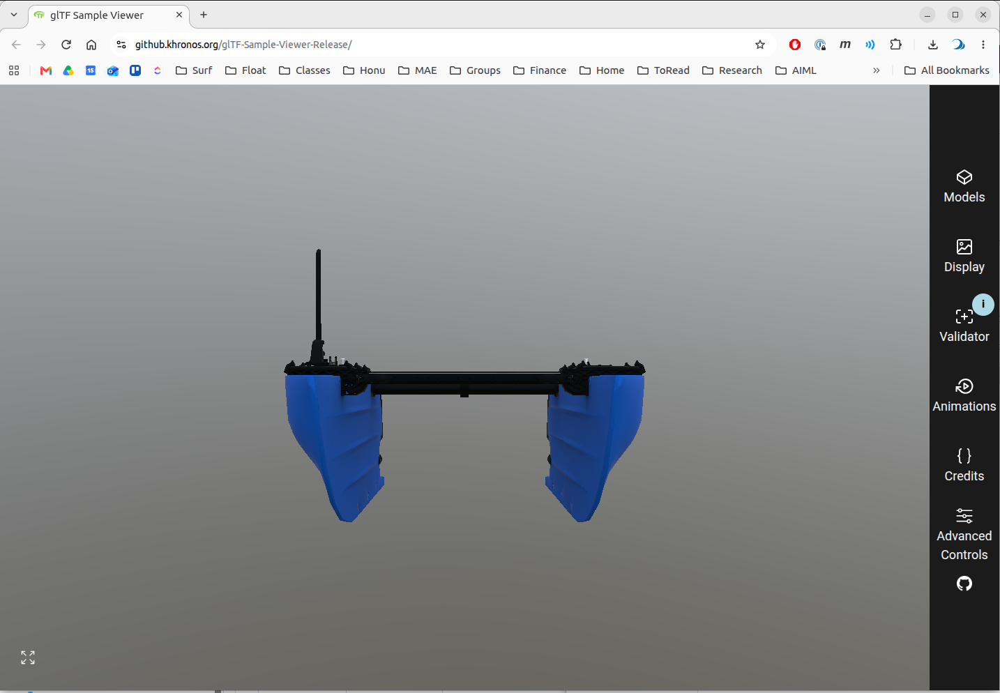
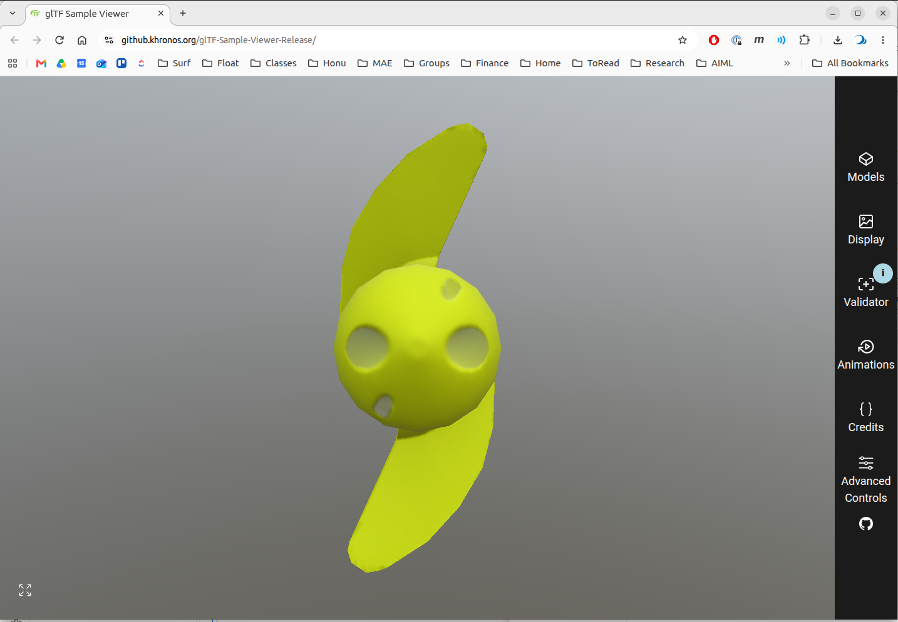

# BlueBoat gltf Walkthrough

This page documents the [workflow](../workflow.md) applied to the BlueBoat USV model in the bluerobotics_models]() repo.  The purpose is to illustrate the workflow applied to a minimal exaple.

## Step 1: Commission

The commission contains three parts.

The commission gets it's own PR - https://github.com/HonuRobotics/bluerobotics_models/pull/84

## Step 2: Author  3D asset

The individual models and .blend assembly are included in https://github.com/HonuRobotics/bluerobotics_models/pull/83

## Step 3: Fill the manifest from the commission

The integrator uses `gltf_robotics.manifest` and the commission YAML file to write the meta data [manifest](../profile.md#the-manifest) into each delivered file. from the commission. 

The inputs are the commission `bluerobotics_parts/commissions/commission-blueboat.yaml` from [PR #84](https://github.com/HonuRobotics/bluerobotics_models/pull/84) and the three `<part>_visual.glb` files from [PR #83](https://github.com/HonuRobotics/bluerobotics_models/pull/83). The step runs once PR #84 is approved, on PR #83's branch, so the stamped files land in the delivery PR.

The commands on this page assume the gltf-robotics tools are installed as in [Installing the tools](https://github.com/HonuRobotics/gltf-robotics#installing-the-tools), which puts `gltf-manifest`, `gltf-check` and `gltf-summary` on the `PATH`.

From the `bluerobotics_models` root, with the commission available on the branch:

```bash
M=bluerobotics_parts/models
gltf-manifest \
    bluerobotics_parts/commissions/commission-blueboat.yaml \
    $M/blueboat_chassis/blueboat_chassis_visual.glb \
    $M/m200_weedless_prop_cw/m200_weedless_prop_cw_visual.glb \
    $M/m200_weedless_prop_ccw/m200_weedless_prop_ccw_visual.glb
```

The command finds each part's block by the file name (`<part>_visual.glb` → `<part>`), so the commission's part keys must match the delivered names exactly. A dry run on 2026-10-17 with the PR #84 and PR #83 heads, writing to a scratch directory with `-o`, gave:

```
blueboat_chassis_visual.glb: manifest written, 11 properties, role base
m200_weedless_prop_cw_visual.glb: manifest written, 10 properties, role component
m200_weedless_prop_ccw_visual.glb: manifest written, 10 properties, role component
```

If the commission changes during review (for example, the prop datum Ryan is asked to check in PR #84), edit the YAML and rerun the same command; no re-export is needed.

Carried to Step 4, from `gltf-summary` on the same files:

- Each prop file holds both props: two scenes, `m200_weedless_prop_cw` and `m200_weedless_prop_ccw`, differing only in which one the file opens. A delivery is one part per file.
- Node names use the old suffix, `<part>.visual`, in all three files.
- Chassis extent along glTF +Z (forward) is 1.192 m, against the commission's 1.20 m length overall. Prop extent along glTF +Y is 0.111 m, against 112 mm diameter.
- Prop origin reads `x 0.50, y 0.50, z 0.46`, close to the bounding-box midpoint, where the commission's datum is the hub's mating face. Check it against the datum in the Sample Viewer and Gazebo.

## Step 4: Verify

### Valid? Test with Khronos CLI `gltf_validator`

Run the validator tool on all three delivered glb files.  For example, for the cassis part...

```
cd /home/bsb/maritime_ws/src/bluerobotics_models/bluerobotics_parts/models/blueboat_chassis
gltf_validator -o -a blueboat_chassis_visual.glb 
```

Results in 

```
/home/bsb/maritime_ws/src/bluerobotics_models/bluerobotics_parts/models/blueboat_chassis/blueboat_chassis_visual.glb
Errors: 0, Warnings: 1, Infos: 0, Hints: 0
Time: 16ms

        Warnings:
                /meshes/0/primitives/0/material: Material requires a tangent space but the mesh primitive does not provide it. Runtime-generated tangent space may be non-portable across implementations.
    ...
```

The three delivered files from PR #83:

| File | Errors | Warnings | Infos |
|---|---|---|---|
| `blueboat_chassis_visual.glb` | 0 | 1 | 0 |
| `m200_weedless_prop_cw_visual.glb` | 0 | 2 | 0 |
| `m200_weedless_prop_ccw_visual.glb` | 0 | 2 | 0 |

All three are valid glTF: the gate is zero errors.

The tangent space warnings are expected and accepted because:

Every warning is `MESH_PRIMITIVE_GENERATED_TANGENT_SPACE`.  These warnings are expected and acceptable:

- A normal map stores its directions in tangent space, so the renderer needs a tangent at each vertex to apply it. glTF lets the file carry those tangents as a `TANGENT` attribute; when it does not, the renderer generates them itself, and the validator warns that generated tangents **can differ between implementations**. 
- Blender writes no tangents unless the exporter's Tangents option is on
- Neither Gazebo nor RViz reads them ([Geometry](../profile.md#geometry)), so the warning is expected and is accepted with this explanation.

Run on the files after Step 3, the validator adds one info, `UNSUPPORTED_EXTENSION` for `KHR_xmp_json_ld`: the validator cannot check the manifest's extension, which is expected. The manifest itself is checked by `gltf-check`.

#### Why two (not one) errors for the prop files?

The duplicate warnings for the prop files are because each file is actually almost identical and each file contains.  Each file contains BOTH mesh files (CW and CCW). Each prop file contains two scenes...

```
m200_weedless_prop_*_visual.glb:
  scene[0] 'm200_weedless_prop_ccw'
   └─ node[0] 'm200_weedless_prop_ccw.visual'
       └─ mesh[0] 'Cylinder.004'
           └─ primitive[0] ── material 'Prop-CCW-Mat'     ← warning 1

★ scene[1] 'm200_weedless_prop_cw'
   └─ node[1] 'm200_weedless_prop_cw.visual'
       └─ mesh[1] 'Cylinder.007'
           └─ primitive[0] ── material 'Prop-CW-Mat'      ← warning 2
```
The CCW glb opens the first scene.  The CW glb also contains both scenes, but opens the second scene.  

This means we have the same information twice.  This also means that the files should fail future tests we check for compliance with the [profile](../profile.md) which requires one and only one scene per file to avoid this.

### Intended?  Visual check with Khronos sample viewer in browser

This is a qualitative test and requires human evaluation of the visuals.

1. Open [Khronos Sample Viewer](https://github.khronos.org/glTF-Sample-Viewer-Release/)
2. Drag and drop the individual `.glb` files to upload to tool
3. Checks
    - The default, initial view should show the **front** view of the model and the up direction of the model should be up.   This is key because it verifies that the orientation of the mesh is consistent with the [profile](../profile.md) coordinate conventions.
    
    
    - Also rotate, zoom, etc. to visually expect.


### Compliant?  Custom `gltf-check` to enforce [profile]

`gltf-check` tests each file against the [profile](../profile.md) and passes when there are no FAIL lines and every WARN is understood. `gltf-summary` describes what is in the file, and its `origin at` line is checked against the commission's datum. How to read the `gltf-check` output is in [Checking a delivery](checking-a-delivery.md).

Here both run on the files as delivered in PR #83, before Step 3 has written the manifest, because the commission (PR #84) is not yet merged. The manifest test therefore FAILs, and the Units test is OPEN because no dimension is cited; both are decided once Step 3 has run. For the chassis:

```bash
cd ~/maritime_ws/src/bluerobotics_models/bluerobotics_parts/models/blueboat_chassis
```

```bash
gltf-check blueboat_chassis_visual.glb
```

(Can also run `gltf-check -h` for cli options.)

```bash
gltf-summary blueboat_chassis_visual.glb
```

For the props:

```bash
cd ~/maritime_ws/src/bluerobotics_models/bluerobotics_parts/models/m200_weedless_prop_cw
gltf-check m200_weedless_prop_cw_visual.glb
gltf-summary m200_weedless_prop_cw_visual.glb

cd ../m200_weedless_prop_ccw
gltf-check m200_weedless_prop_ccw_visual.glb
gltf-summary m200_weedless_prop_ccw_visual.glb
```

`gltf-check -q` drops the PASS and SKIP lines, `-v` lists every test with its full reason, and `gltf-summary --explain` appends how to read its output.

Every `gltf-check` run also writes the full record as Markdown to `gltf-check-output.md` in the current directory (`--report FILE.md` puts it elsewhere). For the whole delivery at once, the report has a matrix of the three parts side by side, then each file's tests, reasons and scene/node/mesh tree:

```bash
cd ~/maritime_ws/src/bluerobotics_models/bluerobotics_parts/models
gltf-check \
    blueboat_chassis/blueboat_chassis_visual.glb \
    m200_weedless_prop_cw/m200_weedless_prop_cw_visual.glb \
    m200_weedless_prop_ccw/m200_weedless_prop_ccw_visual.glb
```

Results, run on 2026-10-17 on PR #83 at `79eb6ed`. The terminal ends `3 files: 0 compliant, 3 NOT compliant`, and the matrix at the top of `gltf-check-output.md` reads, for the tests that did not pass:

| Test | `blueboat_chassis_visual.glb` | `m200_weedless_prop_cw_visual.glb` | `m200_weedless_prop_ccw_visual.glb` |
|---|---|---|---|
| The manifest | FAIL | FAIL | FAIL |
| Units | OPEN | OPEN | OPEN |
| Scenes and nodes | WARN | FAIL | FAIL |
| Datum specification | SKIP | SKIP | SKIP |
| Materials | WARN | WARN | WARN |
| Verdict | NOT compliant | NOT compliant | NOT compliant |

The other ten tests (File naming, File format, Asset header, Geometry, UV sets, Primitives, Textures, Transparency, Prohibited content, Authoring toolchain) PASS on all three. The chassis has 15 checks (1 FAIL, 2 WARN, 1 OPEN, 10 PASS, 1 SKIP); each prop has 18 (4 FAIL, 2 WARN, 1 OPEN, 10 PASS, 1 SKIP), the extra three being the scene and node counts.

Reading each row that did not pass:

- The manifest, FAIL on all three: `no manifest`, because Step 3 has not been run on these files. Units is OPEN for the same reason (`the manifest cites no dimension`), and Datum specification is SKIP because with no declared role no datum requirement applies. All three are rechecked after Step 3.
- Scenes and nodes, FAIL on both props: `2 scenes, expected exactly 1`, `2 nodes, expected exactly 1` and `2 root nodes, expected exactly 1`. This is the two-scene layout found by the validator above. The two prop files are the same size (552,684 bytes) and their `gltf-summary` output differs only in the line `the file opens scene [0]` or `[1]`. To be fixed in the export: one prop per file.
- Scenes and nodes, WARN on all three: `the root node is not named after the part`. The nodes carry the old suffix, `blueboat_chassis.visual`, where the filename implies `blueboat_chassis`. Renaming the object in Blender clears it.
- Materials, WARN on all three: `metallicFactor unset but carry an ORM map`. With the factor absent glTF's default of 1.0 applies, so metalness comes entirely from the texture's blue channel, which `gltf-check` does not decode. Decoded by hand, the maps are not the all-white case the warning guards against: on the chassis B is 0 for 95.8% of texels and above 128 for 4.1%, so metal is confined to small regions painted in the map; on the props B is 0 throughout (the CW map peaks at 37), so they are not metal. The metalness is where Ryan painted it, and this WARN is understood and accepted. Writing a `metallicFactor` of 0 would clear it but also remove the chassis's metal regions.

To carry forward: the manifest after Step 3, and from Ryan one prop per file and root nodes named after the part.
