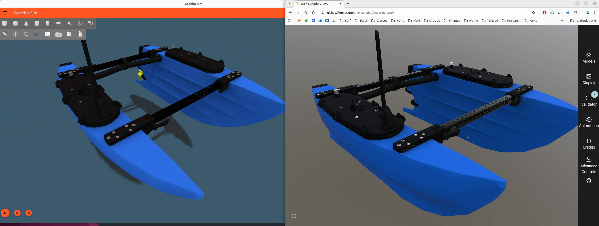

# BlueBoat gltf Walkthrough

This page documents the [workflow](../workflow.md) applied to the BlueBoat USV model in the [bluerobotics_models]() repo.  The purpose is to illustrate the workflow applied to a minimal exaple.

## Step 1: Commission

The commission contains three "parts" in a single YAML file.   This YAML file addition is a PR - https://github.com/HonuRobotics/bluerobotics_models/pull/84

## Step 2: Author  3D asset

The individual models and .blend assembly are included in https://github.com/HonuRobotics/bluerobotics_models/pull/83

## Step 3: Fill the manifest from the commission

The integrator uses `gltf_robotics.manifest` and the commission YAML file to write the meta data [manifest](../profile.md#the-manifest) into each delivered file. from the commission. 

The inputs are the commission `bluerobotics_parts/commissions/commission-blueboat.yaml` from [PR #84](https://github.com/HonuRobotics/bluerobotics_models/pull/84) and the three `<part>_visual.glb` files from [PR #83](https://github.com/HonuRobotics/bluerobotics_models/pull/83). The step runs once PR #84 is approved, on PR #83's branch, so the stamped files land in the delivery PR.

The commands on this page assume the gltf-robotics tools are installed as in [Installing the tools](https://github.com/HonuRobotics/gltf-robotics#installing-the-tools), which puts `gltf-manifest`, `gltf-check` and `gltf-summary` on the `PATH`.

From the `bluerobotics_models` root, with the commission available on the branch:

```bash
M=bluerobotics_parts/models
gltf-manifest \
    bluerobotics_parts/commissions/commission-blueboat.yaml \
    $M/blueboat_chassis/blueboat_chassis_visual.glb \
    $M/m200_weedless_prop_cw/m200_weedless_prop_cw_visual.glb \
    $M/m200_weedless_prop_ccw/m200_weedless_prop_ccw_visual.glb
```

The command finds each part's block (within the commission yaml) by the file name (`<part>_visual.glb` → `<part>`), so the commission's part keys must match the delivered names exactly. Expected results are below...

```
blueboat_chassis_visual.glb: manifest written, 11 properties, role base
m200_weedless_prop_cw_visual.glb: manifest written, 10 properties, role component
m200_weedless_prop_ccw_visual.glb: manifest written, 10 properties, role component
```

## Step 4: Verify

### Valid? Test with Khronos CLI `gltf_validator`

Run the validator tool on all three delivered glb files.  For example, for the cassis part...

```
cd ~/maritime_ws/src/bluerobotics_models/bluerobotics_parts/models
gltf_validator -o -a blueboat_chassis/blueboat_chassis_visual.glb 
```

Results in 

```
gltf_validator -o -a blueboat_chassis/blueboat_chassis_visual.glb 
/home/bsb/maritime_ws/src/bluerobotics_models/bluerobotics_parts/models/blueboat_chassis/blueboat_chassis_visual.glb
Errors: 0, Warnings: 1, Infos: 1, Hints: 0
Time: 28ms

        Warnings:
                /meshes/0/primitives/0/material: Material requires a tangent space but the mesh primitive does not provide it. Runtime-generated tangent space may be non-portable across implementations.

        Infos:
                /extensionsUsed/0: Cannot validate an extension as it is not supported by the validator: 'KHR_xmp_json_ld'.

{
    "uri": "blueboat_chassis/blueboat_chassis_visual.glb",
    "mimeType": "model/gltf-binary",
    "validatorVersion": "2.0.0-dev.3.10",
    ....
```


The three delivered files from PR #83, after Step 3 has written the manifest:

| File | Errors | Warnings | Infos |
|---|---|---|---|
| `blueboat_chassis_visual.glb` | 0 | 1 | 1 |
| `m200_weedless_prop_cw_visual.glb` | 0 | 2 | 1 |
| `m200_weedless_prop_ccw_visual.glb` | 0 | 2 | 1 |

All three are valid glTF: the gate is zero errors.

The tangent space warnings are expected and accepted because:

Every warning is `MESH_PRIMITIVE_GENERATED_TANGENT_SPACE`.  These warnings are expected and acceptable:

- A normal map stores its directions in tangent space, so the renderer needs a tangent at each vertex to apply it. glTF lets the file carry those tangents as a `TANGENT` attribute; when it does not, the renderer generates them itself, and the validator warns that generated tangents **can differ between implementations**. 
- Blender writes no tangents unless the exporter's Tangents option is on
- Neither Gazebo nor RViz reads them ([Geometry](../profile.md#geometry)), so the warning is expected and is accepted with this explanation.

The one info in each file is `UNSUPPORTED_EXTENSION` for `KHR_xmp_json_ld`, added by Step 3: the validator cannot check the manifest's extension, which is expected. The manifest itself is checked by `gltf-check`.

#### Why two (not one) errors for the prop files?

The duplicate warnings for the prop files are because each file is actually almost identical and each file contains.  Each file contains BOTH mesh files (CW and CCW) - so it is the same warning twice. Each prop file contains two scenes...

```
m200_weedless_prop_*_visual.glb:
  scene[0] 'm200_weedless_prop_ccw'
   └─ node[0] 'm200_weedless_prop_ccw.visual'
       └─ mesh[0] 'Cylinder.004'
           └─ primitive[0] ── material 'Prop-CCW-Mat'     ← warning 1

★ scene[1] 'm200_weedless_prop_cw'
   └─ node[1] 'm200_weedless_prop_cw.visual'
       └─ mesh[1] 'Cylinder.007'
           └─ primitive[0] ── material 'Prop-CW-Mat'      ← warning 2
```
The CCW glb opens the first scene.  The CW glb also contains both scenes, but opens the second scene.  

This means we have the same information twice.  This also means that the files should fail future tests we check for compliance with the [profile](../profile.md) which requires one and only one scene per file to avoid this.

### Intended?  Visual check with Khronos sample viewer in browser

This is a qualitative test and requires human evaluation of the visuals.

1. Open [Khronos Sample Viewer](https://github.khronos.org/glTF-Sample-Viewer-Release/)
2. Drag and drop the individual `.glb` files to upload to tool
3. Checks
    - The default, initial view should show the **front** view of the model and the up direction of the model should be up.   This is key because it verifies that the orientation of the mesh is consistent with the [profile](../profile.md) coordinate conventions.
    
    
    - Also rotate, zoom, etc. to visually expect.

#### Khronos vs Gazebo

To set expectations, this image shows the blueboat glb file both in the Khronos viewer and in Gazebo.  They are visually quite different.   This is likely due to lighting within Gazebo.  When in doubt, trust the official Khronos viewer.



### Compliant?  Custom `gltf-check` to enforce [profile](../profile.md)

* `gltf-check` tests each file against the [profile](../profile.md) and passes when there are no FAIL lines and every WARN is understood. 
* `gltf-summary` describes what is in the file, and its `origin at` line is checked against the commission's datum. How to read the `gltf-check` output is in [Checking a delivery](checking-a-delivery.md).

Start at root of repo:

```
cd ~/maritime_ws/src/bluerobotics_models
```

For the chassis:

```bash
gltf-check bluerobotics_parts/models/blueboat_chassis/blueboat_chassis_visual.glb
```

The tool reports the results to stdout and writes a markdown report (default output file is `gltf-check-output.md`).  Use `-h` for details.   The chassis part passes:

```
bluerobotics_parts/models/blueboat_chassis/blueboat_chassis_visual.glb  compliant; 2 WARN to review before delivering (Scenes and nodes, Materials)
  15 checks: 2 WARN, 13 PASS

  WARN  Scenes and nodes     the root node is not named after the part
        'blueboat_chassis.visual'. the filename implies 'blueboat_chassis'
  WARN  Materials            1 material leaves metallicFactor unset but carry an ORM map
        Gazebo Compliant glTF Material (metallicFactor unset, so 1.0, metallicRoughness texture present). (more with -v)

  PASS  13: File naming, File format, The manifest, Asset header, Units, Datum specification, Geometry, UV sets, Primitives, Textures, Transparency, Prohibited content, Authoring toolchain

report written to gltf-check-output.md
```

For the cw prop:

```bash
gltf-check bluerobotics_parts/models/m200_weedless_prop_cw/m200_weedless_prop_cw_visual.glb
```

This part fails
```
bluerobotics_parts/models/m200_weedless_prop_cw/m200_weedless_prop_cw_visual.glb  NOT compliant: 3 MUSTs are violated in Scenes and nodes
  18 checks: 3 FAIL, 2 WARN, 13 PASS

  FAIL  Scenes and nodes     2 scenes, expected exactly 1
  FAIL  Scenes and nodes     2 nodes, expected exactly 1
        'm200_weedless_prop_ccw.visual', 'm200_weedless_prop_cw.visual'. A part is one node: placement belongs to the SDF visual pose and the joint tree, not to the asset
  FAIL  Scenes and nodes     2 root nodes, expected exactly 1
        'm200_weedless_prop_ccw.visual', 'm200_weedless_prop_cw.visual'
  WARN  Scenes and nodes     2 root nodes are not named after the part
        'm200_weedless_prop_ccw.visual', 'm200_weedless_prop_cw.visual'. the filename implies 'm200_weedless_prop_cw'
  WARN  Materials            2 materials leave metallicFactor unset but carry an ORM map
        Prop-CCW-Mat (metallicFactor unset, so 1.0, metallicRoughness texture present); Prop-CW-Mat (metallicFactor unset, so 1.0, metallicRoughness texture present). (more with -v)

  PASS  13: File naming, File format, The manifest, Asset header, Units, Datum specification, Geometry, UV sets, Primitives, Textures, Transparency, Prohibited content, Authoring toolchain

report written to gltf-check-output.md
```

The detailed report is archived at [gltf-check-output.md](./gltf-check-output.md)

The issues in this case are illustrative of the details that are not immediately evident.  We can introspect further with
```
gltf-summary bluerobotics_parts/models/m200_weedless_prop_cw/m200_weedless_prop_cw_visual.glb
```

Which gives us a summary of the gltf layout
```
bsb@hulihuli:~/maritime_ws/src/bluerobotics_models$ gltf-summary bluerobotics_parts/models/m200_weedless_prop_cw/m200_weedless_prop_cw_visual.glb
bluerobotics_parts/models/m200_weedless_prop_cw/m200_weedless_prop_cw_visual.glb  (553708 bytes, .glb)
  glTF 2.0   exported by: Khronos glTF Blender I/O v5.2.40
  extensions: used ['KHR_xmp_json_ld']  required []
  manifest: KHR_xmp_json_ld present

  scenes: 2 total; the file opens scene [1]
    scene [0] 'm200_weedless_prop_ccw' lists 1 root node: [0]
    scene [1] 'm200_weedless_prop_cw' lists 1 root node: [1]
  nodes: 2 total, 2 root, 0 child
    node [0] 'm200_weedless_prop_ccw.visual'  root   -> mesh [0]
        translation [0, 0, 0]                  absent, so glTF's default applies
        rotation    [0, 0, 0, 1]               absent, so glTF's default applies (identity)
        scale       [1, 1, 1]                  absent, so glTF's default applies
                    -> node space and scene space coincide
    node [1] 'm200_weedless_prop_cw.visual'  root   -> mesh [1]
        translation [0, 0, 0]                  absent, so glTF's default applies
        rotation    [0, 0, 0, 1]               absent, so glTF's default applies (identity)
        scale       [1, 1, 1]                  absent, so glTF's default applies
                    -> node space and scene space coincide
  meshes: 2 instantiated, holding 2 primitives in total
    mesh [0] 'Cylinder.004'  -- 1 primitive
      primitive [0]  NORMAL + POSITION + TEXCOORD_0   material: Prop-CCW-Mat
        -- in NODE space, where the node origin is zero
        vertex min/max   [-0.02147, -0.05548, -0.03101] -> [0.02148, 0.05524, 0.03635]   declared by the accessor
        bbox midpoint    [5.868e-06, -0.0001216, 0.002666]
        vertex mean      [5.63e-06, -0.0001615, 0.002848]   over 431 vertices, split at UV seams, so not the authoring tool's count
    mesh [1] 'Cylinder.007'  -- 1 primitive
      primitive [0]  NORMAL + POSITION + TEXCOORD_0   material: Prop-CW-Mat
        -- in NODE space, where the node origin is zero
        vertex min/max   [-0.02133, -0.0546, -0.0313] -> [0.02133, 0.05572, 0.03638]   declared by the accessor
        bbox midpoint    [0, 0.0005572, 0.002542]
        vertex mean      [5.665e-07, 0.000473, 0.002841]   over 431 vertices, split at UV seams, so not the authoring tool's count

  geometry in NODE space, which is also SCENE space here -- no node carries a transform
    bounding box  [-0.02147, -0.05548, -0.0313] -> [0.02148, 0.05572, 0.03638]
                  union over 2 primitives, unchanged from the vertex min/max above
    extent        [0.04296, 0.1112, 0.06768]   = max - min of that box
    origin at     x 0.50, y 0.50, z 0.46   = (0 - min) / extent, per axis
                  0 = minimum face, 0.5 = midpoint of the bounding box, 1 = maximum face

  materials: 2 total
    material [0] 'Prop-CCW-Mat'  metallic absent, so glTF's default of 1.0 applies  roughness None  MASK  doubleSided
       textures: baseColorTexture, metallicRoughnessTexture, normalTexture, occlusionTexture
    material [1] 'Prop-CW-Mat'  metallic absent, so glTF's default of 1.0 applies  roughness None  MASK  doubleSided
       textures: baseColorTexture, metallicRoughnessTexture, normalTexture, occlusionTexture
  images: 4 total  ['image/png', 'image/png', 'image/png', 'image/png']
```

`gltf-check -q` drops the PASS and SKIP lines, `-v` lists every test with its full reason, and `gltf-summary --explain` appends how to read its output.

Every `gltf-check` run also writes the full record as Markdown to `gltf-check-output.md` in the current directory (`--report FILE.md` puts it elsewhere). For the whole delivery at once, the report has a matrix of the three parts side by side, then each file's tests, reasons and scene/node/mesh tree:

```bash
cd ~/maritime_ws/src/bluerobotics_models/bluerobotics_parts/models
gltf-check \
    blueboat_chassis/blueboat_chassis_visual.glb \
    m200_weedless_prop_cw/m200_weedless_prop_cw_visual.glb \
    m200_weedless_prop_ccw/m200_weedless_prop_ccw_visual.glb
```

Results, run on 2026-10-17 on PR #83 at `79eb6ed` with the Step 3 manifest written. The terminal ends `3 files: 1 compliant, 2 NOT compliant`, and the matrix at the top of `gltf-check-output.md` reads, for the tests that did not pass:

| Test | `blueboat_chassis_visual.glb` | `m200_weedless_prop_cw_visual.glb` | `m200_weedless_prop_ccw_visual.glb` |
|---|---|---|---|
| Scenes and nodes | WARN | FAIL | FAIL |
| Materials | WARN | WARN | WARN |
| Verdict | compliant | NOT compliant | NOT compliant |


Reading each row that did not pass:

- Scenes and nodes, FAIL on both props: `2 scenes, expected exactly 1`, `2 nodes, expected exactly 1` and `2 root nodes, expected exactly 1`. This is the two-scene layout found by the validator above. The two prop files are the same size (553,708 bytes with the manifest) and their `gltf-summary` output differs only in the line `the file opens scene [0]` or `[1]`. To be fixed in the export: one prop per file.
- Scenes and nodes, WARN on all three: `the root node is not named after the part`. The nodes carry the old suffix, `blueboat_chassis.visual`, where the filename implies `blueboat_chassis`. Renaming the object in Blender clears it.
- Materials, WARN on all three: `metallicFactor unset but carry an ORM map`. With the factor absent glTF's default of 1.0 applies, so metalness comes entirely from the texture's blue channel, which `gltf-check` does not decode. Decoded by hand, the maps are not the all-white case the warning guards against: on the chassis B is 0 for 95.8% of texels and above 128 for 4.1%, so metal is confined to small regions painted in the map; on the props B is 0 throughout (the CW map peaks at 37), so they are not metal. The metalness is where Ryan painted it, and this WARN is understood and accepted. Writing a `metallicFactor` of 0 would clear it but also remove the chassis's metal regions.

## Round 1 result: what went back to Ryan

To carry forward, from Ryan: one prop per file and root nodes named after the part.

## Round 2: re-export of the props (PR #83 at `e6f369b`)

Ryan re-exported the two props so that each file holds one scene and one node. Against the round 1 head (`79eb6ed`), the net change in [PR #83](https://github.com/HonuRobotics/bluerobotics_models/pull/83) is:

- The two prop GLBs are re-exported. The chassis GLB and the three `model.sdf` files are unchanged.
- The commission from [PR #84](https://github.com/HonuRobotics/bluerobotics_models/pull/84) has been merged and is now on the PR branch, byte for byte the file used in round 1.

Each step below was rerun on 2026-10-18 from the `bluerobotics_models` root on the PR head, with the same commands as round 1.

### Step 3: Fill the manifest

The `gltf-manifest` command is unchanged and writes the same manifests as in round 1:

```
bluerobotics_parts/models/blueboat_chassis/blueboat_chassis_visual.glb: manifest written, 11 properties, role base
bluerobotics_parts/models/m200_weedless_prop_cw/m200_weedless_prop_cw_visual.glb: manifest written, 10 properties, role component
bluerobotics_parts/models/m200_weedless_prop_ccw/m200_weedless_prop_ccw_visual.glb: manifest written, 10 properties, role component
```

### Valid?

| File | Round 1 (Errors / Warnings / Infos) | Round 2 (Errors / Warnings / Infos) |
|---|---|---|
| `blueboat_chassis_visual.glb` | 0 / 1 / 1 | 0 / 1 / 1 |
| `m200_weedless_prop_cw_visual.glb` | 0 / 2 / 1 | 0 / 1 / 1 |
| `m200_weedless_prop_ccw_visual.glb` | 0 / 2 / 1 | 0 / 1 / 1 |

Each prop now carries one mesh, so it has one tangent space warning instead of two. The prop files are no longer identical: 342,012 bytes (CW) and 337,480 bytes (CCW) with the manifest, against 553,708 bytes each in round 1.

### Compliant?

For the cw prop, the same command as round 1:

```bash
gltf-check bluerobotics_parts/models/m200_weedless_prop_cw/m200_weedless_prop_cw_visual.glb
```

Now passes:

```
bluerobotics_parts/models/m200_weedless_prop_cw/m200_weedless_prop_cw_visual.glb  compliant; 2 WARN to review before delivering (Scenes and nodes, Materials)
  15 checks: 2 WARN, 13 PASS

  WARN  Scenes and nodes     the root node is not named after the part
        'm200_weedless_prop_cw.visual'. the filename implies 'm200_weedless_prop_cw'
  WARN  Materials            1 material leaves metallicFactor unset but carry an ORM map
        Prop-CW-Mat (metallicFactor unset, so 1.0, metallicRoughness texture present). (more with -v)

  PASS  13: File naming, File format, The manifest, Asset header, Units, Datum specification, Geometry, UV sets, Primitives, Textures, Transparency, Prohibited content, Authoring toolchain
```

The three scene and node FAILs are gone, and with them the three extra checks: the prop has 15 checks, like the chassis. `gltf-summary` shows why:

```
bluerobotics_parts/models/m200_weedless_prop_cw/m200_weedless_prop_cw_visual.glb  (342012 bytes, .glb)
  glTF 2.0   exported by: Khronos glTF Blender I/O v5.2.40
  extensions: used ['KHR_xmp_json_ld']  required []
  manifest: KHR_xmp_json_ld present

  scenes: 1 total; the file opens scene [0]
    scene [0] 'm200_weedless_prop_cw' lists 1 root node: [0]
  nodes: 1 total, 1 root, 0 child
    node [0] 'm200_weedless_prop_cw.visual'  root   -> mesh [0]
        translation [0, 0, 0]                  absent, so glTF's default applies
        rotation    [0, 0, 0, 1]               absent, so glTF's default applies (identity)
        scale       [1, 1, 1]                  absent, so glTF's default applies
                    -> node space and scene space coincide
  meshes: 1 instantiated, holding 1 primitive in total
    mesh [0] 'Cylinder.007'  -- 1 primitive
      primitive [0]  NORMAL + POSITION + TEXCOORD_0   material: Prop-CW-Mat
        -- in NODE space, where the node origin is zero
        vertex min/max   [-0.02133, -0.0546, -0.0313] -> [0.02133, 0.05572, 0.03638]   declared by the accessor
        bbox midpoint    [0, 0.0005572, 0.002542]
        vertex mean      [5.665e-07, 0.000473, 0.002841]   over 431 vertices, split at UV seams, so not the authoring tool's count

  geometry in NODE space, which is also SCENE space here -- no node carries a transform
    bounding box  [-0.02133, -0.0546, -0.0313] -> [0.02133, 0.05572, 0.03638]
                  union over 1 primitive, unchanged from the vertex min/max above
    extent        [0.04267, 0.1103, 0.06768]   = max - min of that box
    origin at     x 0.50, y 0.49, z 0.46   = (0 - min) / extent, per axis
                  0 = minimum face, 0.5 = midpoint of the bounding box, 1 = maximum face

  materials: 1 total
    material [0] 'Prop-CW-Mat'  metallic absent, so glTF's default of 1.0 applies  roughness None  MASK  doubleSided
       textures: baseColorTexture, metallicRoughnessTexture, normalTexture, occlusionTexture
  images: 3 total  ['image/png', 'image/png', 'image/png']
```

Compared with round 1, the file holds one scene, one node, one mesh and one material, where it held two of each. The mesh is the same `Cylinder.007` with the same vertex bounds, so the geometry did not change; only the CCW prop left the file. With the union gone, the extent is the CW prop's own, and its diameter along glTF +Y is 0.1103 m (0.1107 m for the CCW prop) against the commission's nominal 112 mm, which the Units test passes.

The three-file run, with the same command as round 1, ends `3 files: 3 compliant, 0 NOT compliant`. The rows that did not pass in either round:

| Test | Round 1: chassis / cw / ccw | Round 2: chassis / cw / ccw |
|---|---|---|
| Scenes and nodes | WARN / FAIL / FAIL | WARN / WARN / WARN |
| Materials | WARN / WARN / WARN | WARN / WARN / WARN |
| Verdict | compliant / NOT compliant / NOT compliant | compliant / compliant / compliant |

The detailed round 2 report is archived at [gltf-check-output-round2.md](./gltf-check-output-round2.md).

What remains is two WARNs on each file:

- Scenes and nodes: the root nodes still carry the old suffix (`m200_weedless_prop_cw.visual`), as in round 1.
- Materials: unchanged and accepted, as read in round 1. The props' metallic maps decode as before (B is 0 throughout; the CW map peaks at 37), and the commission specifies both props as non-metal.

We could rename the root nodes after the part (`blueboat_chassis`, `m200_weedless_prop_cw`, `m200_weedless_prop_ccw`), but that isn't functional and a detail not worth another iteration. 
